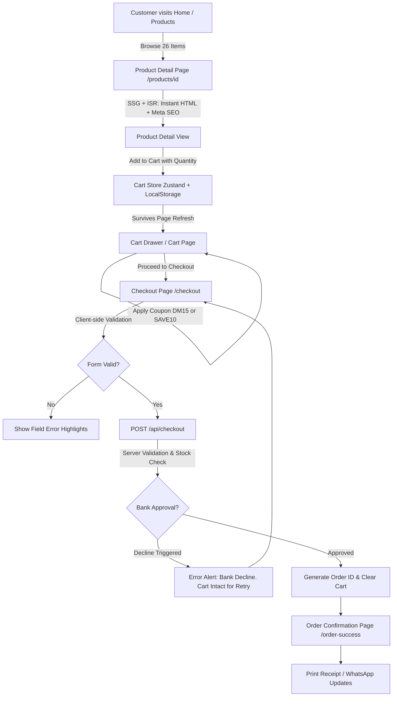

# 🛍️ LUMINA Workspace Store — Day 2 Customer Storefront

> **7 Day Challenge | Day 2 of 7**: Customer-facing e-commerce storefront built with Next.js (App Router), React 19, TypeScript, and Tailwind CSS.

---

## 📖 Context & Story
For months, the store sold custom mechanical keyboards, studio audio equipment, ambient task lamps, and ergonomic desk accessories exclusively over **WhatsApp and Instagram DMs**. 

As sales volume increased, customers needed a real website:
- **Search Engine Discovery**: Product pages indexed on Google with rich OpenGraph meta tags and structured schema.org JSON-LD.
- **Self-Serve Browsing & Ordering**: Interactive catalog, category filters, real-time search, responsive cart drawer, and checkout.
- **Retained DM Charm**: WhatsApp chat links throughout the site, a 15% discount code (`DM15`) for returning DM customers, and an order receipt with one-tap WhatsApp status alerts.

---

## 🚀 How to Run It

### 1. Prerequisites
- Node.js `v20+` or `v22+`
- npm `v10+`

### 2. Installation
```bash
git clone <repo-url>
cd customer-storefront
npm install
```

### 3. Run Development Server
```bash
npm run dev
```
Open [http://localhost:3000](http://localhost:3000) in your browser.

### 4. Build and Production Run
```bash
npm run build
npm run start
```

### 5. Run Automated Tests
```bash
# Run unit & server-side validation tests
npm test

# Run Playwright End-to-End flow test
npm run test:e2e
```

---

## ✅ What is Done

### 1. Home Page (`/`)
- [x] **Hero Section**: High-contrast, brand-aligned headline ("Elevate Your Desk. Deepen Your Focus."), value propositions, customer counter metrics, and direct CTA buttons.
- [x] **Value Badges**: Free express delivery on $80+, 30-day trial, 2-year warranty, and direct DM support.
- [x] **Category Links Showcase**: Visual cards for Keyboards, Audio, Lighting, and Workspaces.
- [x] **Featured Products**: Grid of bestselling workspace upgrades with quick-add actions and star reviews.
- [x] **WhatsApp Migration Banner**: Welcomes WhatsApp/Instagram DM customers with exclusive 15% discount code (`DM15`).

### 2. Product Listing Page (`/products`)
- [x] **26 Seeded Products**: Detailed catalog with authentic high-resolution images, specs, inventory counts, and ratings.
- [x] **Category Filter**: Instant filtering across 6 categories (Workspaces, Keyboards, Mice, Audio, Lighting, Desk Accessories).
- [x] **Sort by Price, Rating, Name**: Sort Low-to-High, High-to-Low, Highest Rated, and A-Z.
- [x] **Real-Time Search**: Search by product name, description, or category keyword.
- [x] **URL Query Synchronization**: All filters (`?category=...&sort=...&q=...`) live in the URL so links can be shared and bookmarked.
- [x] **Active Filter Pills & Reset**: Visual filter tags with one-click "Clear All".
- [x] **Empty State**: Friendly graphic and suggestions when zero products match the query.

### 3. Product Detail Page (`/products/[id]`)
- [x] **Server-Rendered**: Pre-rendered via SSG/ISR with `generateStaticParams()` for all 26 seeded products.
- [x] **SEO & Social Sharing ("Found on Google")**: Dynamic `generateMetadata()` provides unique `<title>`, `<meta description>`, OpenGraph tags, and Twitter Cards per product.
- [x] **Schema.org Structured Data**: Embedded JSON-LD microdata (`Product`, `Offer`, `AggregateRating`) for Google rich search snippets.
- [x] **Interactive Gallery**: High-res image display with zoom hover effect and badge overlays.
- [x] **Stock Inventory Display**: Visual stock indicators (e.g., "In Stock (18 available)", "⚡ Low Stock: Only 4 left!").
- [x] **Quantity Selector**: Quantity stepper bounded by available inventory.
- [x] **Add to Cart & Express Buy Now**: Button animated with checkmark feedback + direct "Buy Now" checkout jump.
- [x] **Related Products**: Contextual recommendations from the same category.
- [x] **Proper 404**: Triggers Next.js `notFound()` for invalid product IDs with custom 404 page.

### 4. Cart (`/cart` & Slide-Out Cart Drawer)
- [x] **Cart Actions**: Add, remove, increment/decrement quantity, and subtotal calculation.
- [x] **Persistence**: Cart survives page reloads and browser sessions via Zustand `persist` with `localStorage`.
- [x] **Zero Hydration Mismatch**: Safe client hydration check prevents SSR hydration warnings.
- [x] **Header Cart Badge**: Dynamic cart item count visible in the sticky header on every page.
- [x] **Discount Codes (Bonus)**: Working promo code engine supporting `DM15` (15% off), `SAVE10` (10% off), `FREESHIP`, and `OFF25`.
- [x] **Free Shipping Bar**: Interactive progress indicator showing how close the customer is to unlocking free shipping ($80 threshold).
- [x] **Empty State**: Polished state with "Browse Products" CTA.

### 5. Checkout (`/checkout`)
- [x] **Customer Form**: Name, email, phone number, street address, city, state, postal code.
- [x] **Client-Side Validation**: Inline field validations with visual error messages.
- [x] **Server-Side Validation**: Backend API route (`POST /api/checkout`) verifies required customer fields, valid email format, phone length, cart items, and live stock limits. Never trusts client input.
- [x] **Fake Payment Step**: Realistic card inputs (card number, expiry, CVC) with test sandbox explanation.
- [x] **Simulated Bank Failure & Retry**: 
  - Checkbox toggle "Simulate Payment Decline" OR entering a card ending in `0000` triggers a bank decline.
  - Cart remains **100% intact**.
  - Clear red error alert banner displayed.
  - User can modify details or retry payment with 1 click.
- [x] **Order Confirmation (`/order-success`)**:
  - Displays unique generated Order ID (e.g., `ORD-849201`).
  - Itemized receipt, shipping address, and delivery date estimate.
  - Cart is wiped cleanly upon success.
  - "Print Receipt" and "WhatsApp Status Alert" integrations.

### 6. Mock Backend API (`app/api/...`)
- [x] **`GET /api/products`**: Query filters, sorting, 300-800ms delay, and simulated network response.
- [x] **`GET /api/products/[id]`**: Single product lookup with delay.
- [x] **`POST /api/checkout`**: Rigorous validation, delay, and test decline triggers.
- [x] **`GET /api/orders/[id]`**: Mock order lookup for receipts.

### 7. Automated Tests
- [x] **Unit & Business Logic Tests** (`tests/cart.test.ts`): Cart totals, subtotal math, discount codes, shipping fees, sales tax.
- [x] **Server Validation Tests** (`tests/checkout-validation.test.ts`): Email regex, empty cart rejection, inventory limits, and decline triggers.
- [x] **Playwright E2E Test** (`tests/storefront.spec.ts`): Exactly 1 complete end-to-end user purchase journey (Home -> Open Product -> Add to Cart -> Checkout -> See Confirmation Page).

---

## 🏗️ Rendering Strategy Decision & Rationale

| Route / Page | Strategy | Rationale |
| :--- | :--- | :--- |
| **Home Page (`/`)** | **SSG** (Static Site Generation) | Pre-rendered at build time. Serves instantly from edge cache with 0ms server compute delay. First impression is lightning fast. |
| **Catalog Listing (`/products`)** | **Client Component + URL Query Params + Suspense** | Needs real-time, responsive multi-faceted filtering, sorting, and search without round-trip server latency. Filters mirror directly to the URL (`?category=...&sort=...`) for shareable links. |
| **Product Detail (`/products/[id]`)** | **SSG + ISR** (`revalidate = 60`) | **Why chosen?** E-commerce product discovery lives and dies by SEO ("found on Google" requirement). Pre-generating all 26 product HTML pages with `generateStaticParams()` guarantees instant Googlebot indexing, superior Core Web Vitals (LCP < 0.8s), and full OpenGraph preview cards. ISR (`revalidate = 60`) ensures price and inventory changes update in the background automatically without rebuilding the application. |
| **Cart Page (`/cart`)** | **Client (Zustand Persist)** | Highly user-specific local state. Saved to `localStorage` so items survive page refresh or closing tabs. Protected with a hydration barrier to avoid SSR hydration mismatch. |
| **Checkout (`/checkout`)** | **Client Form + Server Route Handler** | Sensitive interaction requiring fast interactive feedback, client-side validation, and server-side verification at `POST /api/checkout`. |
| **Order Confirmation (`/order-success`)** | **Dynamic Client View** | Reads generated `orderId` from URL query parameters, queries the backend order registry, and displays a printable receipt. |

---

## ⏳ What is Not Done (Deliberate Out-of-Scope)
- **Live Payment Gateway**: Used simulated banking gateway with realistic test triggers instead of actual Stripe/Razorpay keys, as specified in the challenge brief ("Payments can be fake for now").
- **Persistent SQL Database**: Used in-memory mock storage and typed JSON/TS models per prompt instructions ("No real database. Mock data lives in a JSON/TS file on the server side").
- **Customer Account Sign-In**: Kept guest checkout to maximize conversion and speed.

---

## 🛠️ What I Would Fix First with Another 4 Hours
1. **Connect Ops Portal & Storefront Backend**: Connect Day 1 Ops portal and Day 2 Customer storefront to a shared PostgreSQL database (via Prisma or Drizzle ORM) so when an ops manager changes product prices or stock, the customer storefront updates in real-time.
2. **Real Stripe Elements Integration**: Swap the mock payment form with Stripe Checkout or Stripe Elements + Webhooks for real card processing and Apple Pay/Google Pay one-tap purchase.
3. **Live WhatsApp Business Webhook**: Send an automated WhatsApp notification to the customer as soon as the order confirmation is created, containing the order ID, receipt link, and delivery estimate.
4. **Customer Reviews Submission**: Allow verified purchasers to submit star ratings and photo reviews directly on the product detail page.
5. **Multi-Currency & Internationalization**: Add currency selector (USD, EUR, GBP, INR) with real-time conversion rates.

---

## 📐 Architecture & Flow Diagram


